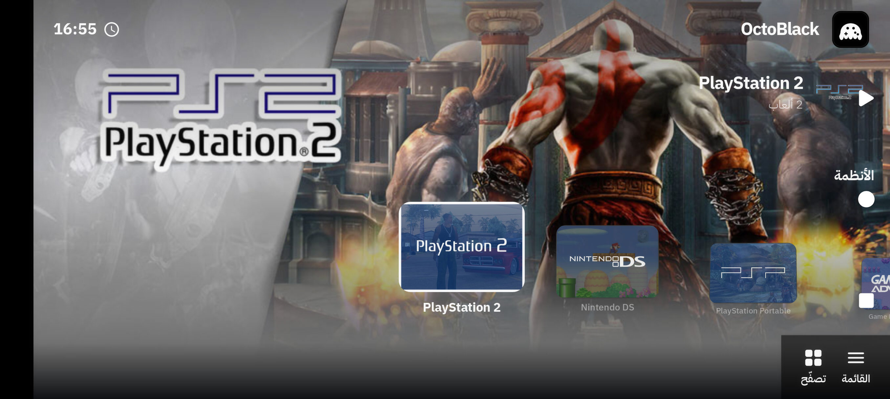
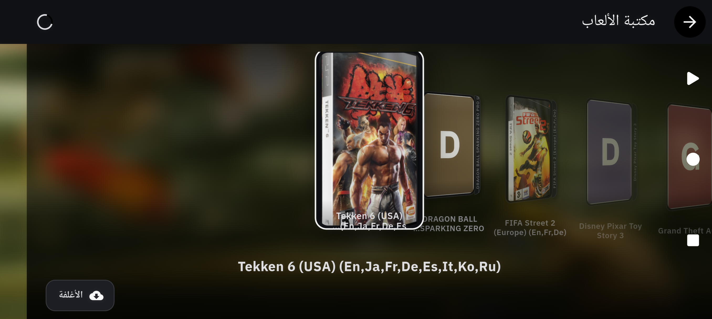
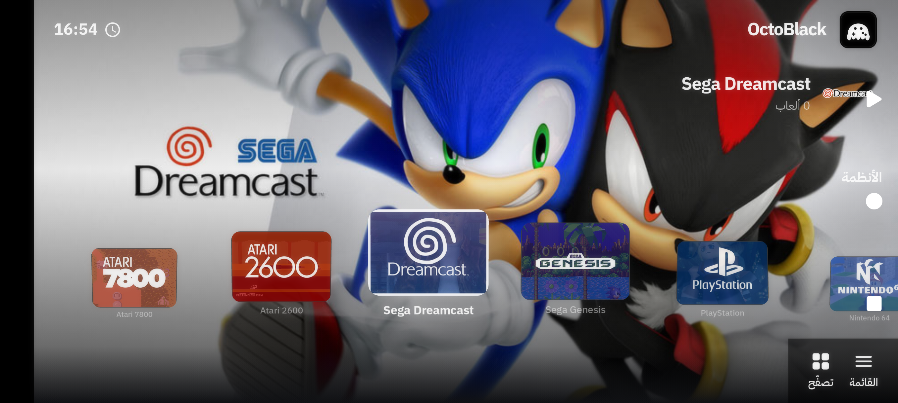
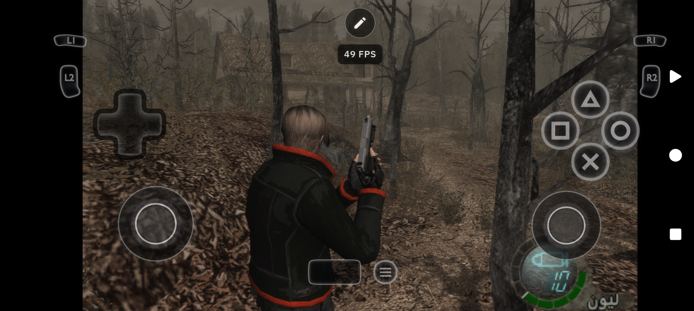

  

<h1 align="center">Octo Black</h1>

  <strong>A premium unified retro-gaming emulator frontend for Android.</strong> 
  13 native libretro cores · 18 verified systems · Arabic &amp; English · arm64 only

  
  
  
  
  
  
  

---

## 🎮 Overview

Octo Black brings your classic gaming collection together in one polished Android app. It binds native **libretro** cores directly through a custom C++ / JNI layer with a Flutter UI, giving you console-quality emulation with a modern library experience — 3D coverflow, per-system artwork, instant search, and a fully localized Arabic/English interface with natural RTL layout.

- **No ROMs are bundled** — bring your own legally obtained backups.
- **Landscape-first** gameplay with a fully customizable touch gamepad.
- **Offline-first**: the app is fully functional without an internet connection (ads and the optional update check are the only network features).

---

## ✨ Features

| | |
|---|---|
| ⚡ **High-performance emulation** | Native ARM64 `.so` libretro cores, direct bindings, zero input latency |
| 📁 **Smart library & folder watcher** | Auto-scans new games, handles archives and multi-disc sets |
| 💾 **Save states & SRAM** | Instant save slots, auto-resume, battery saves preserved per game |
| 🎮 **Customizable touch gamepad** | On-screen editor, analog throttling, Bluetooth gamepad auto-mapping |
| 🕹️ **PocketArch-style overlays** | Faithful D-pad / C-pad / stick overlays for N64, PS1, Genesis, NDS |
| 🛠️ **Integrated CWCheat engine** | Built-in cheat database plus manual code entry for every core |
| 🎛️ **200+ real core options** | Renderers, filters, HD Mode 7, overclocking, per-system presets (Performance / Balanced / Quality) |
| 🌐 **PS2 online-ready tuning** | PSP ad-hoc networking, PRO server, UPnP and public-server support |
| 🎨 **Redesigned UI** | Alekfull-NX style home tiles, 3D coverflow library, per-system background art |
| 🌍 **Fully bilingual** | Arabic (RTL) and English (LTR) with instant switching |
| 📥 **Game Downloads** | Curated collections per device, opened in your external browser |
| 🔔 **Silent update check** | Optional Supabase-backed prompt for newer releases |

---

## 🕹️ Supported Systems

**Verified (runtime-tested on device)**

| System | Core |
|---|---|
| Nintendo Entertainment System | `fceumm` |
| Super Nintendo | `snes9x` |
| Nintendo 64 | `mupen64plus_next_gles3` |
| PlayStation (PS1) | `pcsx_rearmed` |
| PlayStation 2 | `pcee2` |
| Sega Genesis / Master System / Game Gear | `genesis_plus_gx` |
| Atari 2600 | `stella` |
| Atari 7800 | `prosystem` |
| Sega Dreamcast | `flycast` |
| Nintendo GameCube / Wii | `dolphin` |
| Game Boy / Color / Advance | `mgba` |
| PlayStation Portable | `ppsspp` |
| Nintendo DS | `melonds` |

**Planned** — Sega Saturn, Neo Geo MVS, Commodore 64, Amiga, MS-DOS, MAME, Final Burn Neo.

---

## 📸 Screenshots

---

## 📦 Download

| Source | Link |
|---|---|
| 🌐 Official website | [octo-black-website.pages.dev/download.html](https://octo-black-website.pages.dev/download.html) |
| 🐙 GitHub Releases | [Amoryali/octo-black-website/releases](https://github.com/Amoryali/octo-black-website/releases) |
| 📁 MediaFire | [octo-black-1.0.7v-arm64-v8a.apk](https://www.mediafire.com/file/u8ltaw4042cbipo/octo-black-1.0.7v-arm64-v8a.apk/file) |
| 🏪 APKPure (official store listing) | [apkpure.com/p/com.octoblack.octoblackemulatorgames](https://apkpure.com/p/com.octoblack.octoblackemulatorgames) |

> **Requirements:** Android 8.0 (API 26) or higher · 64-bit ARM processor (`arm64-v8a`) · ~190 MB free storage.

---

## 🗺️ Roadmap

- [ ] Sega Saturn core integration
- [ ] Arcade cores (MAME / Final Burn Neo)
- [ ] Cloud save-state sync
- [ ] More store listings (Uptodown, Aptoide)

See [Changelog](https://octo-black-website.pages.dev/changelog.html) for the full release history.

---

## 📣 Disclaimer

Octo Black is an independent emulator frontend and is not affiliated with, endorsed by, or sponsored by Nintendo, Sony, Sega, Atari, or any other trademark holder. All trademarks belong to their respective owners.

---

## 🔗 Links

- **Website:** [octo-black-website.pages.dev](https://octo-black-website.pages.dev)
- **Privacy Policy:** [octo-black-website.pages.dev/privacy.html](https://octo-black-website.pages.dev/privacy.html)
- **FAQ:** [octo-black-website.pages.dev/faq.html](https://octo-black-website.pages.dev/faq.html)
- **Issues:** Use the repository issue tracker for bug reports and feature requests.

---

  © 2026 Octo Black · All rights reserved

